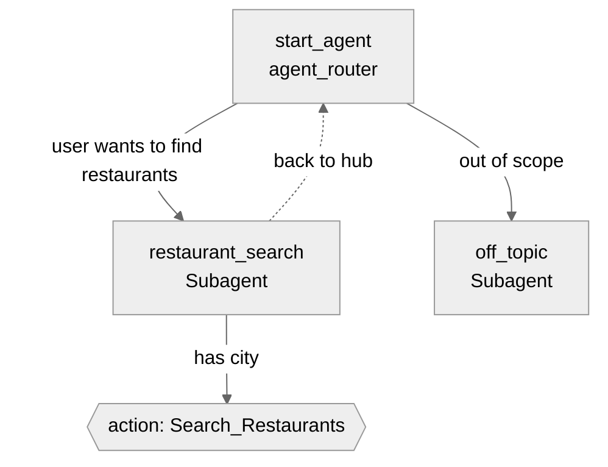

# Agent Spec: Restaurant_Agent

> Reverse-engineered from the existing classic Agentforce metadata
> (`bots/Restaurant_Agent`, `genAiPlannerBundles/Restaurant_Agent`,
> `genAiPlugins/Restaurants_Management`, `genAiFunctions/Search_Restaurants`)
> for migration to Agent Script (`AiAuthoringBundle`).

## Purpose & Scope

An internal employee copilot that helps users find restaurants by city.
Operates in a restaurant listing/management domain.

> **Scope decision:** the legacy topic description mentioned "create bookings,"
> but no booking action was ever implemented. Per direction, this migration
> **matches current behavior minus knowledge**: restaurant search only. The
> "bookings" wording is dropped, and the standard knowledge Q&A action is
> **not** carried over. `Booking__c` is left untouched for a future enhancement.

## Behavioral Intent

- The agent routes restaurant-search requests to a dedicated subagent that
  always uses the `Search_Restaurants` action; it must collect a **city**
  before searching.
- Backing logic: **Apex only** (invocable `RestaurantService`).
- Guardrails: off-topic requests (including general knowledge questions) are
  politely declined and redirected to the agent's purpose. No escalation path
  (employee/internal agent).
- No cross-subagent state needs to persist; each turn is self-contained.

## Subagent Map

## Variables

None required. Search input (`city`) is collected conversationally and passed
directly to the action; no state persists across turns.

## Actions & Backing Logic

### Search_Restaurants (restaurant_search subagent)

- **Target:** `apex://RestaurantService`
- **Backing Status:** **EXISTS** — `force-app/main/default/classes/RestaurantService.cls`,
  `@InvocableMethod searchRestaurants`

#### Inputs

| Name | Type   | Required | Source     |
|------|--------|----------|------------|
| city | string | Yes      | User input |

#### Outputs

| Name        | Type   | Visible to User? | Source                          | Notes |
|-------------|--------|------------------|---------------------------------|-------|
| restaurants | object | Yes              | `Restaurant__c` (list wrapper)  | Rendered by LWC `c/restaurantDetails` via Lightning type `c__restaurantResponse` |

> Output is displayable (`copilotAction:isDisplayable: true` in the legacy
> schema → `filter_from_agent: False`) and used by the planner.

#### Stubbing Requirement

None. Apex, the `restaurantResponse` Lightning type, and the
`c/restaurantDetails` LWC renderer all already exist and are reused unchanged.

## Gating Logic

- `Search_Restaurants`: the subagent must obtain a non-empty `city` from the
  user before invoking the action (instruction-level requirement; no variable
  gate needed).

## Architecture Pattern

**Hub-and-spoke.** `start_agent` (agent_router) routes to `restaurant_search`
or `off_topic`. The spoke returns to the hub. No separate routing subagent.

## Agent Configuration

- **developer_name:** `Restaurant_Agent`
- **agent_label:** `Restaurant Agent`
- **agent_type:** `AgentforceEmployeeAgent` — legacy `agentType=AgentforceEmployeeAgent`,
  `type=InternalCopilot`, template `EmployeeCopilot__AgentforceEmployeeAgent`.
- **default_agent_user:** **Forbidden** (Employee agent). Config block must omit
  `default_agent_user`, `connection messaging:`, and MessagingSession variables.
- **tone:** Casual (legacy `toneType=Casual`).
- **company context:** "Your company provides restaurant management, from
  listing to booking."
